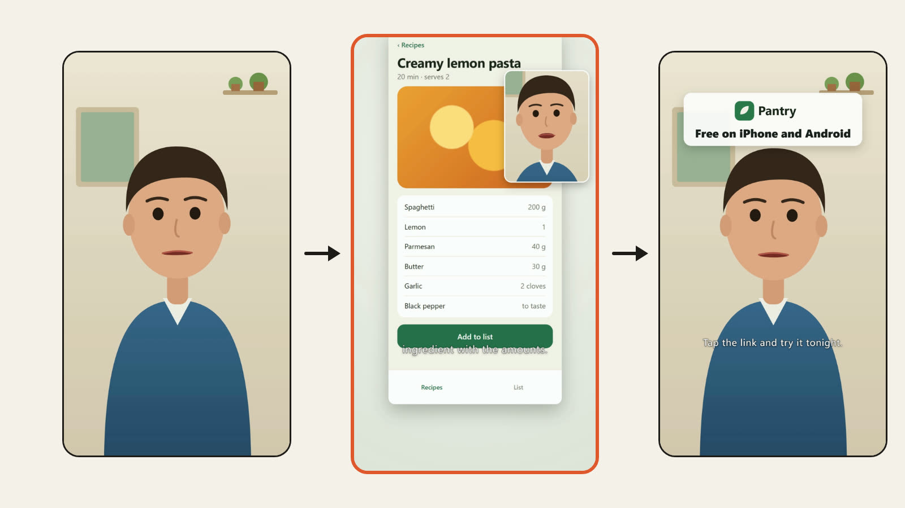

# pip-promo

An [OpenFilm](https://github.com/openfilm/openfilm) skill for the promo format that works for apps and products right
now: the product's own screens fill the frame, and the person selling it talks from a small window. Not a person
holding up a phone, not a slideshow of screenshots: each screen comes on as the speaker names it, and the window
moves out of the way of whatever is being shown.

| | | |
| --- | --- | --- |
|  | [Product promo, speaker in a window](skills/pip-promo) | Your product's real screens fill the frame, each one as you name it, while you talk from a small window that steps out of the way. |

You give it a recording of yourself talking about the product and screen recordings or screenshots of it (a phone app
or a desktop one). It makes a vertical film (or 16:9, square, 4:5) where:

- you fill the frame for the opening line and for the call to action, with your logo and one line over it;
- in between, each demo shot comes on 0.1 s before the words that name it and stays until the next one is named,
  moving in slowly on the part you are talking about;
- your window sits in a corner chosen per shot so it never covers that part, the subtitles or the feed's own buttons;
- ums and long pauses are cut, only inside pauses measured in the sound;
- subtitles come from your transcript through Studio, and a cover is made from a line you said.

## Why a script

An agent can write film.html, but it cannot see which corner of a phone screen is free while it moves in on a button,
and it cannot hear where a pause starts. `skills/pip-promo/scripts/pip.mjs` does both:

- **plan** reads `pip.json` (the recording, each demo with the phrase that brings it on, where its action is) and
  matches each phrase to the transcript's word times, places the window for each shot by trying every slot against
  the camera path of that shot frame by frame and against the edge detail of the footage's own frames, and writes
  film.html's tracks, a page per shot, the call to action and the cover. Tracks it did not make are kept. It says
  what share of the footage's detail is under the window, where one picture holds for long while the speaker names
  things, and a shot that opens on an empty screen.
- **check** measures the film as it stands, after any edits in Studio: frames where the window covers the shown part,
  leaves the frame, sits on the subtitles or floats over no demo; the share of the footage's detail under the window,
  and whether another place covers less; each shot against its word; held pictures; speaker cuts in pauses; subtitles
  drawn into a page, and whether the subtitles' style (the project's, or a caption track's) reads on a white screen.
  With `--video` it also finds the picture changes in a render and times them against the words.

Where the action is comes from a take filmed with [web-demo](https://github.com/WEBGRS/openfilm-web-demo) or
[app-demo](https://github.com/WEBGRS/openfilm-app-demo) (its clicks and marks), or from `focus` rects the agent writes
after looking at the footage. `scripts/cuts.mjs` is the pause measure from
[talking-head](https://github.com/WEBGRS/openfilm-talking-head), copied here with its functions exported. Node and
ffmpeg only, no packages.

The official `presenter-pip` skill covers the same layout for lessons and talks, as a brief; this one is for promos
and adds the planning and the measurements.

## The sample

`node tools/make-sample.mjs` builds a test project in `out/sample`: a drawn presenter voiced on this computer with
[local-voice](https://github.com/WEBGRS/openfilm-local-voice) (with an um and two long pauses on purpose), a phone app
filmed with web-demo from `tools/sample/steps.json`, a logo and a music bed. Copy `tools/sample/pip.json` beside it and
run `pip.mjs plan`, `npx openfilm render --subtitles` and `pip.mjs check --video sample.mp4`. On that sample
(November 2026): 23.7 s cut to 19.9 s in 2 cuts, both in pauses; three demo shots, each on 0.10 s before its word in
film.html and 0.07 to 0.09 s before it in the render; the window up for 11.3 s and over the shown part, off the frame,
or over the subtitles in 0 frames; `look --full` found no flash, jump, still or black frame.

## Use it

- **In OpenFilm**: open Skills, add one from a link, and paste `https://github.com/WEBGRS/openfilm-pip-promo`.
- **In your own agent** (Claude Code, Codex and others): `npx skills add WEBGRS/openfilm-pip-promo`.

It needs a transcription service connected in OpenFilm (Settings → Providers), Node 22 or later, and ffmpeg.

## Check

```sh
node scripts/check.mjs
node --test test/*.test.mjs   # needs ffmpeg
```

## 中文说明

做获客、带货、App 推广视频用的 OpenFilm 技能，现在最好用的那种版式：产品的真实画面占满屏幕，讲解的人在一个小窗里。不是人举着手机比划，也不是截图轮播：说到哪个功能，那段演示就出现，小窗自己让开正在演示的地方。

素材是你对着镜头讲产品的录像，加上产品的录屏或截图（手机 App 或电脑软件都行）。出来的是竖屏片子（也可以 16:9、1:1、4:5）：

- 开头那句和结尾的行动号召由你占满全屏，结尾叠上 logo 和一句话；
- 中间每段演示在说出功能名前 0.1 秒出现，一直留到下一个功能被说出，镜头缓缓推近正在讲的地方；
- 小窗每个镜头选一个角落，保证不挡演示的重点、不挡字幕、不挡平台按钮；
- 口癖和长停顿会剪掉，刀口只落在声音实测的停顿里；
- 字幕由 Studio 从你的转写生成，封面用你说过的一句话。

脚本 `pip.mjs` 做智能体做不到的两件事：`plan` 读 `pip.json`，把每个功能名对上转写里的词时间，逐帧试每个角落和这个镜头的推拉路径，并读素材画面的边缘细节，挑出遮得最少的位置，写出 film.html 的轨道、每个镜头一页、行动号召页和封面页，别的轨道原样保留；`check` 量出当前片子（包括在 Studio 里改过之后）小窗挡住演示重点、出画、压字幕、底下没有演示的帧数，窗口下面压住了素材多少细节、换个位置能不能更少，每个镜头离它的词差多少，一张画面撑太久没有，剪点是否都在停顿里，页面里有没有画字幕，字幕的样式在白底上看不看得清；加 `--video` 还会在成片里找画面切换的时刻，对到词上。

演示的重点位置来自 web-demo 或 app-demo 录的素材（点击和标记），或者智能体看过画面后写的 `focus` 矩形。`cuts.mjs` 是 talking-head 的停顿测量，复制过来并导出了函数。只需要 Node 和 ffmpeg。

官方的「小窗人物口播」（presenter-pip）是讲课、讲解用的同一版式，只有需求书；这个专做推广，多了规划和测量。

**安装**：在 OpenFilm 的技能页点「添加 skill」，粘贴 `https://github.com/WEBGRS/openfilm-pip-promo`；用自己的智能体就运行 `npx skills add WEBGRS/openfilm-pip-promo`。需要在 OpenFilm 的设置 → 服务商里连好一个语音转写服务，以及 Node 22 以上和 ffmpeg。
